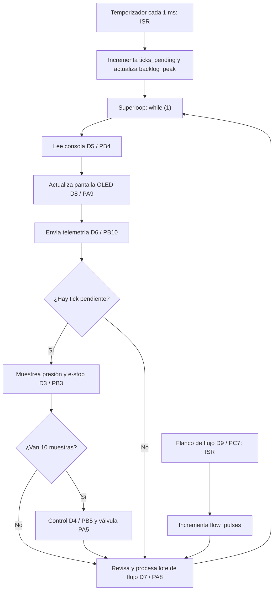

# RET — Informe de Evidencia de Tiempos

**Grupo:** `María Prieto Ortega` `Rafael Torres Choperena` `Mariana Zuluaga Yepes`  ·  **Placa:** `Nucleo-L476RG`

## 1. El sistema y su conjunto de tareas 

| ID | Requisito |
|---|---|
| REQ-SAMP-01 | Mientras el sistema está activo, deberá ejecutar el muestreo de presión y e-stop cada 1 ms, dentro de un plazo de 1 ms. |
| REQ-CTRL-01 | Mientras el sistema está irrigando, deberá ejecutar el control cada 10 ms, dentro de un plazo de 10 ms. |
| REQ-CONS-01 | Cuando el operador ingrese un comando válido, el sistema deberá procesarlo y mostrar la respuesta correspondiente en la consola. |
| REQ-TEL-01 | Mientras el sistema está activo, deberá publicar telemetría cada 1 s. |
| REQ-HMI-01 | Mientras la HMI está habilitada, deberá actualizar la pantalla cada 500 ms. |
| REQ-FLOW-01 | Cuando se acumulen 100 pulsos de flujo, deberá procesar el lote en la siguiente iteración disponible del superloop. |
| REQ-SAFE-01 | Si se presenta una sobrepresión o se activa la parada de emergencia, el sistema deberá cerrar la válvula para garantizar la seguridad. |

### Tareas y tiempos de ejecución en Nucleo-L476RG (Lab 2)

| Tarea | Req. | Tipo | Período / activación | Fecha límite | `C_i` observado | Método |
|---|---|---|---|---|---:|---|
| Muestreo | REQ-SAMP-01 | Duro | 1 ms | 1 ms | 5 µs | Ancho de pulso D3, Logic 2 |
| Control | REQ-CTRL-01 | Duro | 10 ms | 10 ms | 2.5 µs | Ancho de pulso D4, Logic 2 |
| Consola (`help`) | REQ-CONS-01 | Firme | Por evento | No definida | 1.313 ms | Ancho de pulso D5, Logic 2 |
| Telemetría | REQ-TEL-01 | Suave | 1 s | 1 s | 6.1555 ms | Ancho de pulso D6, Logic 2 |
| Lote de flujo | REQ-FLOW-01 | Firme | Cada 100 pulsos | No definida | 70.5 µs | Ancho de pulso D7, Logic 2 |
| Pantalla OLED | REQ-HMI-01 | Suave | 500 ms | 500 ms | 25.06 ms | Ancho de pulso D8, Logic 2 |

### Tareas y tiempos de ejecución en ESP32-C6 (Lab 3)

| Tarea | Requisito | Tipo | Período | Deadline | `C_i` máximo medido |
|---|---|---|---:|---:|---:|
| Muestreo | REQ-SAMP-01 | Duro | 1 ms | 1 ms | 12,937 µs |
| Control PI | REQ-CTRL-01 | Duro | 10 ms | 10 ms | 34,500 µs |
| Consola (`calib`) | REQ-CONS-01 | Firme | Esporádica | No definido | 408,623 ms |
| Telemetría USB | REQ-TELE-01 | Suave | 1 s | Flexible | 50,442 ms |
| Lote de flujo | REQ-FLOW-01 | Suave | Cada 100 pulsos | No definido | No medido |
| Pantalla OLED | REQ-HMI-01 | Suave | 500 ms | 500 ms | No medida en C6 |

## Tareas Laboratorios

### Diagrama del superloop — Lab 2, tarea A

## Lectura del flujo

- El temporizador genera una interrupción cada 1 ms. La ISR no ejecuta el muestreo: incrementa `ticks_pending` y actualiza `backlog_peak` si se acumulan ticks.

- El superloop recorre siempre el mismo orden: consola, pantalla OLED y telemetría. Después revisa si hay un tick de muestreo pendiente.

- Si existe un tick pendiente, ejecuta el muestreo de presión y e-stop en D3. Cada diez muestras ejecuta además el control en D4 y actualiza la válvula en PA5.

- La entrada de flujo llega por D9/PC7. Su ISR incrementa `flow_pulses`; el superloop revisa ese contador en la tarea de lote de flujo, instrumentada en D7.

- La tarea de flujo se revisa en cada vuelta del ciclo. Cuando no hay tick pendiente, el superloop pasa directamente desde la telemetría hacia la revisión de flujo.

- Como todas las tareas comparten un solo `while (1)`, una tarea lenta bloquea temporalmente a las demás. La actualización de OLED y el comando `calib` pueden retrasar el muestreo y acumular `ticks_pending`.

## 2. ADRs

### ADR-001 — `<title>`
**Context:** … · **Decision:** … · **Justification (with numbers):** … · **Status:** …

## 3. Evidencia por semana

Each entry cites the `REQ`(s) it verifies.

### Semana 2 — línea base del superloop

**Placa:** Nucleo-L476RG  
**Instrumento:** Logic 2  
**Señales:** D3 muestreo, D4 control, D5 consola, D6 telemetría,
D7 lote de flujo, D8 OLED y D9 entrada de flujo.

| **Medición** | **Valor obtenido** | **Referencia** |
|---|---:|---|
| Período real de muestreo, promedio | **999 µs** | 1000 µs |
| Jitter máximo de muestreo durante ≥ 30 s | **22 870 µs** | Línea base con OLED y caché |
| Latencia ISR → servicio del superloop, pulso de flujo | **12.5 µs** | D9 → D7 |
| Jitter máximo de muestreo con la caché flash desactivada | **24 580 µs** | Aumentó ≈ 1710 µs frente a la línea base |
| Jitter de muestreo con el comando bloqueante activo | **431 332 µs** | Comando `calib` |
| `backlog_peak`, inactivo → durante el comando bloqueante | **30 → 432 ticks** | Contador interno del firmware |

> **Criterio usado para jitter máximo tardío:**
>
> `jitter = período máximo observado − 1000 µs`
>
> Este valor indica cuánto se retrasó la ejecución de muestreo frente a su
> período nominal de 1 ms.

La frecuencia media se mantuvo cercana a 1 kHz, pero la actualización de la OLED produjo huecos de hasta 25.58 ms en D3. El comando `calib` bloqueó el único superloop durante 408.882 ms, acumuló 432 ticks y retrasó tanto el muestreo como el control.

### Análisis de causa raíz del comando `calib`

En `firmware/superloop/src/main.c:409`, la función `cmd_calib()` ejecuta
`k_busy_wait(400)` dentro de un ciclo de 1000 rondas. Esto bloquea el
superloop aproximadamente 400 ms. El comando se invoca desde
`console_handle()` en la línea 434 y la consola se ejecuta dentro del único
`while (1)` en la línea 503. Mientras la calibración no retorna, el programa
no atiende `ticks_pending`; por ello se observó un período máximo de D3 de
432.332 ms y `backlog_peak=432`.

### Semana 3 — Comparación de la línea base del C6 y el silicio

Aunque la guía está diseñada para el ESP32-S3, en este caso se utilizó un
ESP32-C6 Super Mini. Sin embargo, el objetivo de la práctica se mantiene:
realizar el port mediante devicetree y trasladar el muestreo a un hilo de
ejecución.

| Medición | Nucleo Lab 2 | C6 superloop | C6 + `sampling thread` |
|---|---:|---:|---:|
| Jitter máximo normal | 22,870 ms | 50,446 ms | 2 µs |
| Período máximo normal | 23,870 ms | 51,446 ms | 1,001 ms |
| Jitter con `calib` | 431,332 ms | 408,297 ms | 2 µs |
| Período máximo con `calib` | 432,332 ms | 409,297 ms | 1,001 ms |
| `backlog_peak` con `calib` | 432 ticks | 409 ticks | 0 ticks |
| `lat_peak_us` | — | — | 9 µs |
| Período máximo de control con `calib` | — | 416,317 ms | 420,004 ms |
| Duración de `calib` | 408,882 ms | 407,482 ms | 408,516 ms |

#### Evidencia del port

El port se realizó mediante
`firmware/superloop/boards/esp32c6_devkitc_hpcore.overlay`. El archivo define
los GPIO de la ESP32-C6, la entrada de flujo, la válvula, las señales de
instrumentación y la consola USB Serial/JTAG.

La aplicación se compiló, se grabó en la placa y respondió al comando `status`.
La lógica funcional no requirió reescritura para adaptar los pines; los cambios
dependientes de la placa se concentraron en el overlay.

#### Comparación de silicios

Aunque la ESP32-C6 funciona a una frecuencia mayor que la Nucleo-L476RG, su
superloop tuvo mayor jitter máximo normal: 50,446 ms frente a 22,870 ms. La frecuencia de CPU no determina por sí sola el peor caso: la consola USB,
`printk`, la ejecución desde flash con caché y las tareas bloqueantes influyen
en el tiempo máximo observado.

La comparación es indicativa: la Nucleo se midió con analizador lógico y la C6
con instrumentación interna mediante `k_cycle_get_32()`.

#### Sampling frente a control durante `calib`

Durante `calib`, el hilo de muestreo mantuvo jitter máximo de 2 µs, período
máximo de 1,001 ms y `backlog_peak=0`; por ello cumple REQ-SAMP-01.

Control permaneció en el superloop y alcanzó un período máximo de 420,004 ms,
mayor que su deadline de 10 ms. Por tanto, REQ-CTRL-01 no se cumple durante
`calib`.

#### Estado compartido

| Variable | Escritores | Lectores |
|---|---|---|
| `pressure_mv` | Hilo de muestreo | Control, telemetría, pantalla y `status` |
| `estop` | Hilo de muestreo y comando `clear` | Control, telemetría, pantalla y `status` |
| `setpoint_mv` | Joystick y comando `set` | Control, telemetría, pantalla y `status` |

El programa funciona en esta prueba porque la C6 tiene un solo núcleo principal
y usa enteros alineados, pero en C todavía pueden existir carreras de datos.

## 4. Schedulability analysis

U = ΣC_i/T_i with **measured** C_i; test used (RM / hyperbolic / EDF); RTA as a
script with its output; blocking B_i if there are mutexes. (Formulas: READINGS.md,
"The math that does get used".)

## 5. Functional safety (final project)

Declared safe state (failure ⇒ valve closed), watchdog, and the evidence of the
fail-safe firing.

