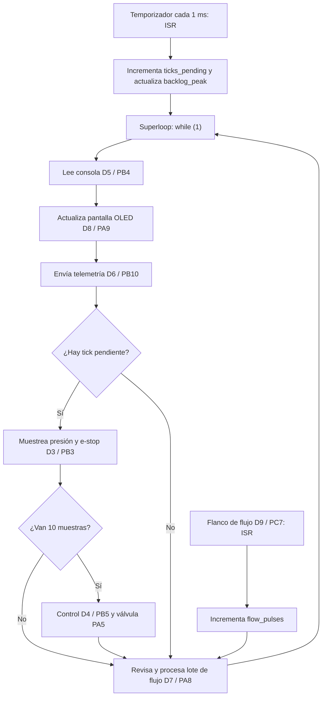

# RET — Informe de Evidencia de Tiempos

**Grupo:** `María Prieto Ortega` `Mariana Zuluaga Yepes`  ·  **Placa:** `Nucleo-L476RG` - `ESP32-C6 Super Mini`

## 1. El sistema y su conjunto de tareas 

| ID | Requisito |
|---|---|
| REQ-SAMP-01 | Mientras el sistema está activo, deberá ejecutar el muestreo de presión y e-stop cada 1 ms, dentro de un plazo de 1 ms. |
| REQ-CTRL-01 | Mientras el sistema está irrigando, deberá ejecutar el control cada 10 ms, dentro de un plazo de 10 ms. |
| REQ-CONS-01 | Cuando el operador ingrese un comando válido, el sistema deberá procesarlo y mostrar la respuesta correspondiente en la consola. |
| REQ-TEL-01 | Mientras el sistema está activo, deberá publicar telemetría cada 1 s. |
| REQ-HMI-01 | Mientras la HMI está habilitada, deberá actualizar la pantalla cada 500 ms. |
| REQ-FLOW-01 | Cuando se acumulen 100 pulsos de flujo, deberá procesar el lote en la siguiente iteración disponible del superloop. |
| REQ-SAFE-01 | Si se presenta una sobrepresión o se activa la parada de emergencia, el sistema deberá cerrar la válvula para garantizar la seguridad. |

### Tareas y tiempos de ejecución en Nucleo-L476RG (Lab 2)

| Tarea | Req. | Tipo | Período / activación | Fecha límite | `C_i` observado | Método |
|---|---|---|---|---|---:|---|
| Muestreo | REQ-SAMP-01 | Duro | 1 ms | 1 ms | 5 µs | Ancho de pulso D3, Logic 2 |
| Control | REQ-CTRL-01 | Duro | 10 ms | 10 ms | 2.5 µs | Ancho de pulso D4, Logic 2 |
| Consola (`help`) | REQ-CONS-01 | Firme | Por evento | No definida | 1.313 ms | Ancho de pulso D5, Logic 2 |
| Telemetría | REQ-TEL-01 | Suave | 1 s | 1 s | 6.1555 ms | Ancho de pulso D6, Logic 2 |
| Lote de flujo | REQ-FLOW-01 | Firme | Cada 100 pulsos | No definida | 70.5 µs | Ancho de pulso D7, Logic 2 |
| Pantalla OLED | REQ-HMI-01 | Suave | 500 ms | 500 ms | 25.06 ms | Ancho de pulso D8, Logic 2 |

### Tareas y tiempos de ejecución en ESP32-C6 (Lab 3)

| Tarea | Requisito | Tipo | Período | Deadline | `C_i` máximo medido |
|---|---|---|---:|---:|---:|
| Muestreo | REQ-SAMP-01 | Duro | 1 ms | 1 ms | 12,937 µs |
| Control PI | REQ-CTRL-01 | Duro | 10 ms | 10 ms | 34,500 µs |
| Consola (`calib`) | REQ-CONS-01 | Firme | Esporádica | No definido | 408,623 ms |
| Telemetría USB | REQ-TELE-01 | Suave | 1 s | Flexible | 50,442 ms |
| Lote de flujo | REQ-FLOW-01 | Suave | Cada 100 pulsos | No definido | No medido |
| Pantalla OLED | REQ-HMI-01 | Suave | 500 ms | 500 ms | No medida en C6 |

> **Nota para Labs 5 y 6:** El análisis de planificabilidad usa los `C_i`
> finales obtenidos mediante instrumentación/tracing en la ESP32-C6:
> muestreo = 12 µs, control = 5 µs y telemetría = 165 µs. Los valores de la
> tabla anterior corresponden a la línea base histórica del Lab 3.

### Tareas y tiempos de ejecución en ESP32-C6 — Labs 4 y 5

| Tarea | Prioridad | Período / deadline | `C_i` máximo |
|---|---:|---|---:|
| `sampling_tid` | 2 | 1 ms / 1 ms | 12 µs |
| `control_tid` | 3 | 10 ms / 10 ms | 5 µs |
| `flow_wq` | 5 | Cada 100 pulsos / no definido | 165 µs |
| `display_tid` | 7 | 500 ms / 500 ms | No medido |
| `telemetry_tid` | 8 | 1 s / 1 s | 165 µs |
| `console_tid` | 9 | Esporádica / no definido | 400,030 ms |

### Tareas y tiempos de ejecución ESP32-C6 (Lab 6)

| ID | Requisito |
|---|---|
| REQ-CALIB-01 | Cuando el operador ingrese el comando `calib`, el sistema deberá completar la calibración dentro de 1 s. |
| REQ-ESTOP-01 | Cuando se detecte sobrepresión, el sistema deberá llevar la válvula a bajo dentro de 5 ms. |

## Tareas Laboratorios

### Diagrama del superloop — Lab 2, tarea A



## Lectura del flujo

- El temporizador genera una interrupción cada 1 ms. La ISR no ejecuta el muestreo: incrementa `ticks_pending` y actualiza `backlog_peak` si se acumulan ticks.

- El superloop recorre siempre el mismo orden: consola, pantalla OLED y telemetría. Después revisa si hay un tick de muestreo pendiente.

- Si existe un tick pendiente, ejecuta el muestreo de presión y e-stop en D3. Cada diez muestras ejecuta además el control en D4 y actualiza la válvula en PA5.

- La entrada de flujo llega por D9/PC7. Su ISR incrementa `flow_pulses`; el superloop revisa ese contador en la tarea de lote de flujo, instrumentada en D7.

- La tarea de flujo se revisa en cada vuelta del ciclo. Cuando no hay tick pendiente, el superloop pasa directamente desde la telemetría hacia la revisión de flujo.

- Como todas las tareas comparten un solo `while (1)`, una tarea lenta bloquea temporalmente a las demás. La actualización de OLED y el comando `calib` pueden retrasar el muestreo y acumular `ticks_pending`.

## 2. ADRs

### ADR-001 — Arquitectura del nodo con kernel multihilo

**Contexto:** En la línea base del superloop de la ESP32-C6, el comando
`calib` bloqueó muestreo y control durante aproximadamente 408 ms. El jitter
máximo de muestreo alcanzó 408,297 ms, el período máximo de control alcanzó
416,317 ms y se acumularon 409 ticks.

**Decisión:** Migrar todas las tareas del superloop a entidades del kernel de
Zephyr. Muestreo se ejecuta en `sampling_thread`; control en
`control_thread`; flujo se procesa en la cola de trabajo privada `flow_wq`;
pantalla, telemetría y consola se ejecutan en sus propios hilos. `main`
solamente inicializa el hardware, inicia el temporizador y retorna.

**Justificación:** En la versión con kernel, incluso durante `calib`, el jitter
máximo de muestreo fue 7 µs, el período máximo de control fue 10,005 ms y
`backlog_peak` permaneció en 0. Esto elimina el bloqueo de aproximadamente
408 ms que afectaba las tareas críticas en el superloop.

**Costo:** La transición desde la liberación de control hasta su inicio tuvo un
máximo de 15 µs. Como control se libera 100 veces por segundo, el costo
estimado es `100 × 15 µs = 1.500 µs/s = 1,5 ms/s`.

**Estado:** Aceptada e implementada.

### ADR-002 — Exclusión mutua mediante `k_mutex` con herencia de prioridad

**Contexto:** Con `k_sem`, control esperó 13,086 ms por un recurso compartido,
superando su deadline de 10 ms.

**Decisión:** Usar `k_mutex`, no `k_sem`, para recursos compartidos entre
tareas de diferente prioridad.

**Justificación:** Con `k_mutex`, control esperó 3,056 ms y la sección crítica
del hilo bajo tuvo `B = 3,046 ms`. El RTA calculó
`R_control = 5,523 ms < 10 ms`.

**Estado:** Aceptada e implementada.

### ADR-003 — Captura CTF en RAM para ESP32-C6

**Contexto:** La guía del Lab 5 usa un ESP32-S3 con un puerto para consola y
otro para CTF. La ESP32-C6 Super Mini tiene un único USB Serial/JTAG, por lo
que no fue posible transmitir CTF continuamente por UART sin perder la consola.

**Decisión:** Configurar CTF para almacenar eventos en un búfer de RAM de
65.536 bytes. El búfer se extrajo después mediante JTAG/GDB y se decodificó
con `trace_viewer.py`.

**Justificación:** La captura conservó eventos de ISR, cambios de contexto,
estados `ready`, `running` y `blocked`, semáforos y nombres de hilos. El costo
observado fue un aumento de jitter máximo de muestreo de 7 µs a 43 µs.

**Limitación:** El búfer se llenó y conservó una ventana de aproximadamente
3,14 s; además, JTAG detiene temporalmente el procesador durante la extracción.

**Estado:** Aceptada e implementada para la ESP32-C6 Super Mini.

### ADR-005 — Corrección de `calib` y e-stop en la fuente del retraso

**Contexto:** Antes de la corrección, `calib` consumió 414,884 ms de CPU y
duró 417,254 ms. El e-stop tardó hasta 10,002 ms desde la detección hasta que
la válvula fue llevada a bajo.

**Decisión:** Reemplazar `k_busy_wait(400)` por `k_usleep(400)` en `cmd_calib()`
y asignar `duty_pct = 0` en `task_sampling()` al detectar sobrepresión.

**Justificación:** Después del cambio, `calib` consumió 3,001 ms de CPU, aunque
su duración total fue 2.042,197 ms debido al tick de 1 kHz. El e-stop bajó de
10,002 ms a 3 µs.

**Requisitos afectados:** REQ-CALIB-01 y REQ-ESTOP-01.

**Estado:** REQ-ESTOP-01 cumple: 3 µs < 5 ms. REQ-CALIB-01 no cumple todavía:
la duración total medida fue 2.042,197 ms, superior a 1 s, aunque el consumo de
CPU se redujo a 3,001 ms.

## 3. Evidencia por semana

### Semana 2 — Línea base del superloop  
**Requisitos verificados:** REQ-SAMP-01, REQ-CTRL-01, REQ-FLOW-01.

**Placa:** Nucleo-L476RG  
**Instrumento:** Logic 2  
**Señales:** D3 muestreo, D4 control, D5 consola, D6 telemetría,
D7 lote de flujo, D8 OLED y D9 entrada de flujo.

| **Medición** | **Valor obtenido** | **Referencia** |
|---|---:|---|
| Período real de muestreo, promedio | **999 µs** | 1000 µs |
| Jitter máximo de muestreo durante ≥ 30 s | **22 870 µs** | Línea base con OLED y caché |
| Latencia ISR → servicio del superloop, pulso de flujo | **12.5 µs** | D9 → D7 |
| Jitter máximo de muestreo con la caché flash desactivada | **24 580 µs** | Aumentó ≈ 1710 µs frente a la línea base |
| Jitter de muestreo con el comando bloqueante activo | **431 332 µs** | Comando `calib` |
| `backlog_peak`, inactivo → durante el comando bloqueante | **30 → 432 ticks** | Contador interno del firmware |

> **Criterio usado para jitter máximo tardío:**
>
> `jitter = período máximo observado − 1000 µs`
>
> Este valor indica cuánto se retrasó la ejecución de muestreo frente a su
> período nominal de 1 ms.

La frecuencia media se mantuvo cercana a 1 kHz, pero la actualización de la OLED produjo huecos de hasta 25.58 ms en D3. El comando `calib` bloqueó el único superloop durante 408.882 ms, acumuló 432 ticks y retrasó tanto el muestreo como el control.

### Análisis de causa raíz del comando `calib`

En `firmware/superloop/src/main.c:409`, la función `cmd_calib()` ejecuta
`k_busy_wait(400)` dentro de un ciclo de 1000 rondas. Esto bloquea el
superloop aproximadamente 400 ms. El comando se invoca desde
`console_handle()` en la línea 434 y la consola se ejecuta dentro del único
`while (1)` en la línea 503. Mientras la calibración no retorna, el programa
no atiende `ticks_pending`; por ello se observó un período máximo de D3 de
432.332 ms y `backlog_peak=432`.

### Semana 3 — Comparación de la línea base del C6 y el silicio  
**Requisitos verificados:** REQ-SAMP-01 y REQ-CTRL-01.

Aunque la guía está diseñada para el ESP32-S3, en este caso se utilizó un
ESP32-C6 Super Mini. Sin embargo, el objetivo de la práctica se mantiene:
realizar el port mediante devicetree y trasladar el muestreo a un hilo de
ejecución.

| Medición | Nucleo Lab 2 | C6 superloop | C6 + `sampling thread` |
|---|---:|---:|---:|
| Jitter máximo normal | 22,870 ms | 50,446 ms | 2 µs |
| Período máximo normal | 23,870 ms | 51,446 ms | 1,001 ms |
| Jitter con `calib` | 431,332 ms | 408,297 ms | 2 µs |
| Período máximo con `calib` | 432,332 ms | 409,297 ms | 1,001 ms |
| `backlog_peak` con `calib` | 432 ticks | 409 ticks | 0 ticks |
| `lat_peak_us` | — | — | 9 µs |
| Período máximo de control con `calib` | — | 416,317 ms | 420,004 ms |
| Duración de `calib` | 408,882 ms | 407,482 ms | 408,516 ms |

#### Evidencia del port

El port se realizó mediante
`firmware/superloop/boards/esp32c6_devkitc_hpcore.overlay`. El archivo define
los GPIO de la ESP32-C6, la entrada de flujo, la válvula, las señales de
instrumentación y la consola USB Serial/JTAG.

La aplicación se compiló, se grabó en la placa y respondió al comando `status`.

El primer commit de la adaptación a ESP32-C6 fue `8e72f6f`:

.../esp32c6_devkitc_hpcore.overlay | 12 +++++
firmware/superloop/src/main.c       | 37 ++++++++++++++--
2 files changed, 46 insertions(+), 3 deletions(-)

#### Comparación de silicios

Aunque la ESP32-C6 funciona a una frecuencia mayor que la Nucleo-L476RG, su
superloop tuvo mayor jitter máximo normal: 50,446 ms frente a 22,870 ms. La frecuencia de CPU no determina por sí sola el peor caso: la consola USB,
`printk`, la ejecución desde flash con caché y las tareas bloqueantes influyen
en el tiempo máximo observado.

La comparación es indicativa: la Nucleo se midió con analizador lógico y la C6
con instrumentación interna mediante `k_cycle_get_32()`.

#### Sampling frente a control durante `calib`

Durante `calib`, el hilo de muestreo mantuvo jitter máximo de 2 µs, período
máximo de 1,001 ms y `backlog_peak=0`; por ello cumple REQ-SAMP-01.

Control permaneció en el superloop y alcanzó un período máximo de 420,004 ms,
mayor que su deadline de 10 ms. Por tanto, REQ-CTRL-01 no se cumple durante
`calib`.

#### Estado compartido

| Variable | Escritores | Lectores |
|---|---|---|
| `pressure_mv` | Hilo de muestreo | Control, telemetría, pantalla y `status` |
| `estop` | Hilo de muestreo y comando `clear` | Control, telemetría, pantalla y `status` |
| `setpoint_mv` | Joystick y comando `set` | Control, telemetría, pantalla y `status` |

El programa funciona en esta prueba porque la C6 tiene un solo núcleo principal
y usa enteros alineados, pero en C todavía pueden existir carreras de datos.

### Semana 4 — Migración completa al kernel y comparación A/B  
**Requisitos verificados:** REQ-SAMP-01 y REQ-CTRL-01.

En esta semana se completó la migración del superloop a Zephyr. Las tareas se
organizaron por prioridad: `sampling_thread` (prioridad 2), `control_thread`
(3), `flow_wq` (5), `display_thread` (7), `telemetry_thread` (8) y
`console_thread` (9).

La ISR del temporizador publica las liberaciones de muestreo en `tick_q`.
Cada décima muestra entrega el semáforo `control_sem` para liberar control. La
ISR de flujo programa `task_flow_batch()` en una cola de trabajo privada. Cada
hilo bloquea mientras no tiene trabajo, por lo que no consume CPU esperando.

| Medición (ESP32-C6) | C6 superloop, Semana 3 | Predicción, kernel | Kernel, Semana 4 |
|---|---:|---:|---:|
| Jitter máximo de muestreo | 50,446 ms | ≤ 10 µs | 7 µs |
| Jitter máximo de muestreo con `calib` | 408,297 ms | ≤ 10 µs | 7 µs |
| Período máximo de control con `calib` | 416,317 ms | ≈ 10 ms | 10,005 ms |
| Latencia ISR → hilo (`lat_peak_us`) | — | ≤ 20 µs | 12 µs |
| Brecha interna de liberación a inicio de control | — | ≤ 20 µs | 15 µs |
| Uso máximo de pila de `control_tid` | — | < 1024 bytes | 236 bytes / 1024 bytes asignados |

La brecha de 15 µs se obtuvo mediante instrumentación interna entre la entrega
de `control_sem` y el inicio de `control_thread`. Es una aproximación al costo
de cambio de contexto; no equivale a una medición externa visible en GPIO.

Las mediciones se realizaron en la misma ESP32-C6 y bajo las mismas
condiciones: ejecución normal por al menos 30 segundos y ejecución del comando
`calib`. Debido a que no se contó con analizador lógico para la C6, los valores
se obtuvieron mediante instrumentación interna con `k_cycle_get_32()`.

Durante la condición normal, el kernel mantuvo `backlog_peak=0`,
`samp_jitter_peak_us=7` y `ctrl_period_peak_us=10005`. Durante `calib`, los
mismos máximos se conservaron: `backlog_peak=0`,
`samp_jitter_peak_us=7` y `ctrl_period_peak_us=10005`.

La migración elimina el bloqueo de aproximadamente 408 ms que producía el
superloop. Con el kernel, `calib` se ejecuta en el hilo de consola de menor
prioridad, mientras muestreo y control continúan ejecutándose cerca de sus
períodos nominales.

La evidencia muestra que el bloqueo dejó de causar incumplimientos de cientos
de milisegundos. Sin embargo, el período máximo de control fue 10,005 ms, es
decir, 5 µs superior al deadline estricto de 10 ms. Por tanto, la medición
demuestra una mejora sustancial, pero no constituye por sí sola una prueba
formal de cumplimiento estricto de REQ-CTRL-01.

#### Costo del cambio de contexto

Cada 10 muestras, `sampling_thread` libera `control_thread` mediante
`control_sem` y luego vuelve a bloquearse. La brecha máxima medida entre la
liberación y el inicio de control fue 15 µs.

Control se libera una vez cada 10 ms, es decir, 100 veces por segundo:

`100 liberaciones/s × 15 µs = 1.500 µs/s = 1,5 ms/s`.

Por tanto, el costo máximo estimado de estas transiciones es 1,5 ms por segundo
de ejecución, equivalente a aproximadamente 0,15 % de un segundo.

#### Marcas de uso máximo de pila

El comando `threads`, que ejecuta `thread_analyzer_print(0)`, produjo los
siguientes valores bajo ejecución con telemetría, consola, pantalla y `calib`.

| Hilo o cola de trabajo | Pila usada | Pila asignada | Uso |
|---|---:|---:|---:|
| `sampling_tid` | 252 bytes | 1536 bytes | 16 % |
| `control_tid` | 236 bytes | 1024 bytes | 23 % |
| `flow_wq` | 268 bytes | 1024 bytes | 26 % |
| `display_tid` | 220 bytes | 2048 bytes | 10 % |
| `telemetry_tid` | 660 bytes | 2048 bytes | 32 % |
| `console_tid` | 804 bytes | 2048 bytes | 39 % |

El hilo más cercano a su límite fue `console_tid`, con 804 de 2048 bytes
utilizados (39 %). Ninguna pila mostró riesgo de desbordamiento en esta prueba.

### Semana 5 — Trazado del planificador y preempción
**Requisitos verificados:** REQ-SAMP-01, REQ-CTRL-01 y REQ-CONS-01.

La traza CTF se realizó en la ESP32-C6 Super Mini mediante un búfer de RAM de
65.536 bytes, extraído con JTAG/GDB. La captura contenía 2.764 eventos, cinco
hilos visibles y una ventana de 3.136,906 ms. Se identificaron
`sampling_tid`, `console_tid`, `control_tid`, `display_tid` e `idle`.

| Medición | Valor obtenido | Contraste |
|---|---:|---|
| Cambio de contexto en la traza | 14 µs | `ctx_gap_peak_us` sin tracing: 15 µs |
| ISR → inicio instrumentado de muestreo | 73 µs | `lat_peak_us` sin tracing: 12 µs |
| CPU: `sampling_tid` | 56 % | — |
| CPU: `console_tid` | 13 % | — |
| CPU: `control_tid` | 6 % | — |
| CPU: `display_tid` | 0 % | — |
| CPU: `idle` | 23 % | — |
| Jitter máximo con tracing | 43 µs | Sin tracing: 7 µs |
| Sobrecarga de jitter | 36 µs | `43 - 7` |

#### Decisión de prioridad observada

La secuencia observada fue:

```text
ISR
→ console_tid ready
→ sampling_tid ready
→ sampling_tid running
→ control_tid ready
→ sampling_tid blocked
→ control_tid running
→ control_tid blocked
→ console_tid running
```
Aunque `console_tid` estaba listo, el planificador ejecutó primero
`sampling_tid` y después `control_tid`. Esto confirma que las prioridades del
kernel se respetaron y que la consola de menor prioridad fue aplazada.

#### Precio de observar el sistema

| Magnitud | Tracing activado | Tracing desactivado | Incremento |
|---|---:|---:|---:|
| `lat_peak_us` | 48 µs | 12 µs | +36 µs |
| `samp_jitter_peak_us` | 43 µs | 7 µs | +36 µs |
| `ctrl_period_peak_us` | 10.048 µs | 10.005 µs | +43 µs |
| `ctx_gap_peak_us` | 75 µs | 15 µs | +60 µs |

El tracing incrementó el jitter máximo de muestreo en 36 µs. Por ello CTF es
útil para explicar la secuencia del planificador, pero perturba los tiempos
medidos.

#### Alcance del búfer de trazado

El búfer CTF alcanzó aproximadamente `pos=65331` y `buffer_full=true`, frente
a una capacidad de 65.536 bytes. La captura cubrió aproximadamente 3,14 s;
los eventos posteriores dejaron de almacenarse.

### Semana 6 - Programación: la teoría, puesta a prueba
**Requisitos verificados:** REQ-CTRL-01, REQ-CALIB-01 y REQ-ESTOP-01.

#### Predicciones y resultados

| Medición | Predicción | Resultado observado |
|---|---|---|
| RM | τ2 incumple cerca de 7 ms | τ2: 7,068 ms; incumple |
| EDF | Ningún incumplimiento | `tau1_misses=0`, `tau2_misses=0` |
| Control sin contención | Espera cercana a 0 | 1 µs |
| Control con `k_sem` | El hilo medio retrasa a control | 13,086 ms |
| Control con `k_mutex` | Espera acotada por B | 3,056 ms |
| E-stop antes | Hasta 11 ms | 10,002 ms |
| E-stop después | Cierre en el mismo muestreo | 3 µs |

#### Task A — RM frente a EDF

Se implementó el conjunto de la Figura 4.13: τ1 con `C=2 ms`, `T=D=5 ms` y
τ2 con `C=4 ms`, `T=D=7 ms`.

\[
U=\frac{2}{5}+\frac{4}{7}=0,9714
\]

Con RM, τ2 incumplió su deadline; la primera respuesta registrada fue 7.068 µs
frente a un deadline de 7.000 µs. Con EDF no hubo incumplimientos observados.

#### Task B — Inversión de prioridad

| Régimen | Espera de control | Lectura |
|---|---:|---|
| Sin contención | 1 µs | El recurso estaba libre. |
| `k_sem` | 13,086 ms | Inversión de prioridad. |
| `k_mutex` con PI | 3,056 ms | El hilo bajo heredó la prioridad de control. |

La sección crítica medida con `k_mutex` fue `B = 3,046 ms`.

#### Task C — `calib` y e-stop

| Medición | Antes | Después |
|---|---:|---:|
| Duración de `calib` | 417,254 ms | 2.042,197 ms |
| CPU usada por `calib` | 414,884 ms | 3,001 ms |
| E-stop, máximo de ≥5 pruebas | 10,002 ms | 3 µs |

REQ-ESTOP-01 cumple después de la corrección: el máximo medido fue 3 µs,
menor que el plazo de 5 ms. REQ-CALIB-01 no cumple todavía: `calib` dura
2.042,197 ms, mayor que el plazo de 1 s, aunque ya no bloquea la CPU.

La ESP32-C6 usa `CONFIG_SYS_CLOCK_TICKS_PER_SEC=1000`; por ello
`k_usleep(400)` libera CPU pero se redondea a la granularidad temporal del
kernel y la calibración supera 1 s.

> **Limitación:** La evidencia se obtuvo con instrumentación interna basada en
> `k_cycle_get_32()` y consola. La guía pedía capturas de analizador lógico,
> pero no se contó con ese instrumento para la ESP32-C6.

## 4. Análisis de planificabilidad

### Supuesto sobre las tareas de Daniela

La guía indica que los parámetros de Daniela fueron entregados en clase, pero
no fueron proporcionados al grupo. Se usó el siguiente escenario supuesto; el
resultado debe recalcularse si se reciben parámetros oficiales.

| Tarea | C | T = D |
|---|---:|---:|
| Sensor Daniela A | 2,400 ms | 8 ms |
| Sensor Daniela B | 8,000 ms | 20 ms |

### Utilización

| Tarea | C_i | T_i | C_i/T_i |
|---|---:|---:|---:|
| Muestreo | 12 µs | 1.000 µs | 0,012 |
| Sensor Daniela A | 2.400 µs | 8.000 µs | 0,300 |
| Control | 5 µs | 10.000 µs | 0,0005 |
| Sensor Daniela B | 8.000 µs | 20.000 µs | 0,400 |
| Telemetría | 165 µs | 1.000.000 µs | 0,000165 |

\[
U=0,712665=71,2665\%
\]

\[
U_{LL}=5(2^{1/5}-1)=0,743492
\]

Como \(U < U_{LL}\), el conjunto supuesto queda garantizado bajo RM. El test
hiperbólico también cumple:

\[
(1,012)(1,3)(1,0005)(1,4)(1,000165)=1,843065 \leq 2
\]

### RTA con bloqueo

Con `B_control=3,046 ms` medido usando `k_mutex`, el script
`tools/rta_lab6.py` obtuvo:

| Tarea | R calculado | Deadline | Resultado |
|---|---:|---:|---|
| Muestreo | 12 µs | 1.000 µs | Cumple |
| Sensor Daniela A | 2.436 µs | 8.000 µs | Cumple |
| Control | 5.523 µs | 10.000 µs | Cumple |
| Sensor Daniela B | 12.966 µs | 20.000 µs | Cumple |
| Telemetría | 13.143 µs | 1.000.000 µs | Cumple |

Con `k_sem`, el bloqueo observado fue 13,086 ms y control no cumplió su
deadline. Con `k_mutex`, la herencia de prioridad permite acotar el bloqueo.

### Verificación de REQ-ESTOP-01 y REQ-CALIB-01

Antes de ADR-005:

\[
t_{e-stop} \leq T_{control}+T_{sampling}
=10\text{ ms}+1\text{ ms}=11\text{ ms}
\]

Después de ADR-005, el cierre ocurre dentro del mismo muestreo:

\[
t_{e-stop} \leq C_{sampling}=12\text{ µs}<5\text{ ms}
\]

Con la carga supuesta de Daniela queda:

\[
(1-0,712665)\times1s=287,335\text{ ms de CPU por segundo}
\]

Antes, `calib` requería 414,884 ms de CPU y no cabía. Después requiere
3,001 ms de CPU y sí cabe en CPU, pero su duración real de 2.042,197 ms sigue
superando la deadline de 1 s.

Por tanto, REQ-ESTOP-01 cumple después de ADR-005. REQ-CALIB-01 permanece
incumplido por duración total, pese a que su consumo de CPU sí cabe dentro del
presupuesto de CPU calculado.

## 5. Seguridad funcional (final project)

El estado seguro declarado es válvula cerrada (`duty_pct = 0`). Después de
ADR-005, la detección de sobrepresión asigna ese valor en el mismo muestreo.
El máximo medido para detección → válvula baja fue 3 µs en al menos cinco
pruebas, frente a 10,002 ms antes de la corrección.


